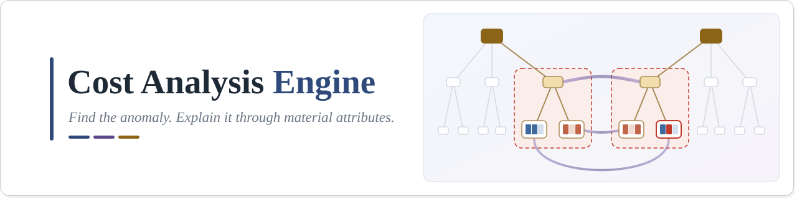
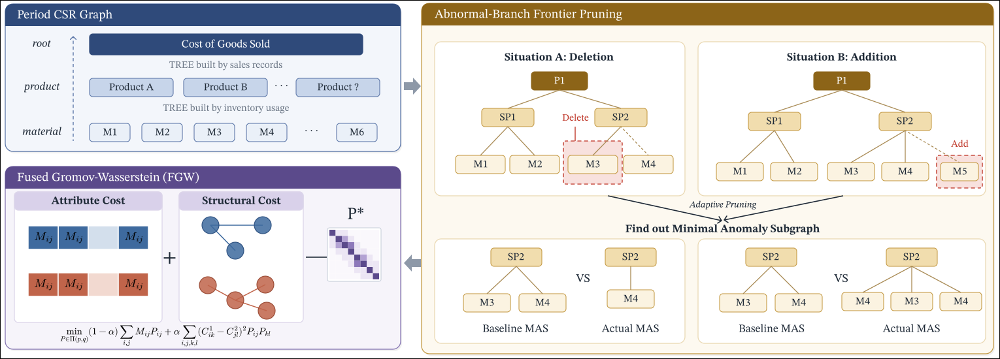

<div align="center">


[](LICENSE)

<picture>
  <source media="(prefers-color-scheme: dark)" srcset="docs/images/banner-dark.svg">
  
</picture>

**English** &nbsp;·&nbsp; [简体中文](README.zh-CN.md)

<br>

### High-Performance Cost Analysis for Multi-Stage Manufacturing

<br>

[**Quick start**](#-quick-start) &nbsp;·&nbsp; [**How it works**](#-how-it-works) &nbsp;·&nbsp; [**Worked example**](#-worked-example)

</div>

<br>

## About

Cost Analysis Engine attributes inter-period changes in unit cost within multi-stage manufacturing to the materials and production runs that cause them. Over a directed acyclic production graph, an exact integer-arithmetic frontier propagates material-level cost changes upwards and stops at the lowest assembly at which each change becomes material, linking every figure to its archived source records. Production runs are then compared with balanced Fused Gromov–Wasserstein optimal transport, whose soft, component-level correspondence identifies a substituted material as a substitution rather than as an unrelated loss and gain. Optional language-model explanations interpret the computed evidence but never produce figures. The FGW solver runs in FP64 on the CPU, on NVIDIA GPUs through a native CUDA implementation, and through OpenCL on other devices, with all execution paths held to the same specified numerical tolerances.



<sub>From the full period graph, abnormal-branch discovery prunes the normal branches down to the minimal anomaly subgraph. The production runs inside it are then compared component by component with FGW.</sub>

I released Cost Analysis Engine as open-source software to accelerate evidence-based cost-variance analysis in practice, and to support reproducible research on cost attribution in multi-stage manufacturing.

<br>

## 🧩 How it works

Given two reporting periods indexed by $t \in \{0, 1\}$ and two materiality thresholds, $\tau_{\text{leaf}}$ and $\tau_{\text{stop}}$, the backend first constructs one graph per period and then executes four analysis stages sequentially, reporting progress on completion of each stage. Monetary quantities are represented as exact decimals throughout, whereas the optimal-transport optimisation is carried out in IEEE 754 double precision (FP64). For each period $t$, sales and inventory-usage records are first aggregated into a directed period graph $G_t = (V_t, E_t)$, in which an edge $(u, v) \in E_t$ indicates that material $u$ is consumed in producing $v$, and each node $v \in V_t$ carries its recorded cost $c_t(v)$.

### 1 · Abnormal branches: thresholded upward frontier

For every node $v \in V_0 \cap V_1$, the inter-period cost difference $\Delta(v) = c_1(v) - c_0(v)$ is computed exactly in signed micro-units, so that $\Delta(v) \in 10^{-6}\,\mathbb{Z}$. Leaves $\ell$ with $|\Delta(\ell)| \ge \tau_{\text{leaf}}$ initialise a frontier that propagates upwards through the period graph; an ancestor $v$ is evaluated only once all of its participating children have reached it, and is selected as a branch boundary $v^\ast$ if $|\Delta(v)| \ge \tau_{\text{stop}}$, otherwise propagation continues to its parents. Because a selected node terminates propagation through its own ancestors, and $\Delta(v)$ is taken from the recorded costs rather than re-summed from its children, each reported path $\ell \to \dots \to v^\ast$ identifies the lowest level of the production graph at which the change becomes material.

### 2 · Production trees: two-pass reconstruction from issue records

Each production order on an abnormal path, identified by the order number carried on its issue records, is reconstructed as a separate tree in two passes. A top-down pass from the product root to every terminal material defines the admissible scope: the node set $S$, the edge set $E_S$ and the root-to-leaf paths. A bottom-up pass then retrieves the actual issue records for these terminals and traces each receiver upwards, accepting it only if it lies in $S$ and is reached through an edge in $E_S$; records that fail this test are retained as explicitly excluded evidence rather than discarded. Node totals are computed from the recorded evidence alone, never from the planned BOM, as $\operatorname{cost}(v) = \sum_{i \to v} m_i + \sum_{(u,v)} (L_{uv} + O_{uv})$, where $m_i$ is the material amount of an issue $i$ received by $v$, and $L_{uv}$ and $O_{uv}$ are the labour and overhead allocated to the relationship $(u, v)$.

> [!WARNING]
> **Current assumption: no cross-period work in progress.** Today every production order is assumed to be started and completed within the selected periods. Orders that are still in progress at a period boundary are not yet handled. The planned extension treats each minimal branch as its own window $w$ and closes it with the standard work-in-progress roll-forward:
>
> ```math
> \text{completed}_w \;=\; \text{opening WIP}_w \;+\; \text{issued in period}_w \;-\; \text{closing WIP}_w
> ```

### 3 · Component embeddings: context-aware semantics

Each node occurrence $v$ in a production tree is rendered as a canonical twelve-field textual template $T(v)$, comprising its code, name, specification, supplier, category and unit cost, together with the codes, names and specifications of its immediate upstream and downstream neighbours, and is embedded by a locally hosted sentence encoder as $x_v = f_\theta(T(v)) \in \mathbb{R}^{384}$. Because the template includes the neighbourhood of $v$, the distance between two embeddings reflects both the attributes of the components and the context in which they are consumed.

### 4 · FGW comparison: matching by attributes and structural position

Two runs of the same product, with trees of $N$ and $M$ nodes and embeddings $\{x_i\}$ and $\{y_j\}$, are compared by balanced Fused Gromov–Wasserstein (FGW) optimal transport. The comparison combines an attribute cost $C_{ij} = \lVert x_i - y_j \rVert_2^2$, all-pairs shortest-path matrices $D_1$ and $D_2$ on the undirected trees, and uniform marginals $p = \tfrac{1}{N}\mathbf{1}$ and $q = \tfrac{1}{M}\mathbf{1}$. The engine seeks the transport plan

```math
P^\ast = \arg\min_{P \in \Pi(p,q)} \; F(P) = (1-\alpha)\,\langle C, P\rangle \;+\; \alpha \sum_{i,j,k,l} \bigl(D_1[i,k] - D_2[j,l]\bigr)^2 P_{ij} P_{kl},
\qquad
\Pi(p,q) = \{P \ge 0 : P\mathbf{1} = p,\; P^{\top}\mathbf{1} = q\},
```

where $\alpha = 0.8$ by default balances attribute similarity against structural position. Because $D_1$ and $D_2$ are symmetric, the quartic structure term never needs to be formed explicitly; it equals $\langle H(P), P\rangle$, with

```math
H(P) = (D_1^{\odot 2}\, p)\,\mathbf{1}^{\top} + \mathbf{1}\,(D_2^{\odot 2}\, q)^{\top} - 2\, D_1 P D_2^{\top}.
```

The problem is solved by Frank–Wolfe, starting from $P_0 = pq^{\top}$. Each iteration linearises $F$ at the current plan, solves the resulting linear transport problem exactly with a transportation simplex, without entropic regularisation, and moves towards its solution:

```math
G = (1-\alpha)\,C + 2\alpha\, H(P), \qquad
Q = \arg\min_{Q \in \Pi(p,q)} \langle G, Q\rangle, \qquad
P \leftarrow P + \gamma^\ast (Q - P).
```

Since $F$ is quadratic along the search direction, the step size $\gamma^\ast \in [0, 1]$ has a closed form. Iteration terminates once the Frank–Wolfe gap satisfies $\langle G, P - Q\rangle \le \varepsilon_{\text{abs}} + \varepsilon_{\text{rel}} \max(|F(P)|, \varepsilon_{\text{floor}})$.

The resulting plan $P$ is a soft correspondence between components. Because no one-to-one assignment is imposed, a substituted material, such as a standard topcoat replaced by a corrosion-resistant one, is matched to its predecessor rather than reported as an unrelated loss and gain.

### Execution paths

| | CPU | CUDA (NVIDIA) | OpenCL |
| :-- | :-- | :-- | :-- |
| Abnormal branches | Java frontier | Native frontier kernel | Native frontier kernel |
| FGW | Serial Java, FP64 | FP64 + cuBLAS batched GEMM, on-device exact simplex ( $N+M \le 320$ ), persistent multi-stream sessions | FP64, device simplex with persistent queues and buffers |

The caller chooses the engine family, and the backend reports which backend actually ran each stage. CUDA never silently falls back to OpenCL, or vice versa, and any CPU fallback is reported with its reason. GPU execution has been tested on a single NVIDIA GPU, with both CUDA and the NVIDIA OpenCL runtime; AMD and Intel devices and Windows/WSL2 have not been tested yet.

### Explanations

For a selected material, the backend first classifies the change from the evidence, for example as a unit-cost change. A **local** llama.cpp model can then write a short explanation of that classification. The model only explains; it never produces the numbers.

<br>

## 🎯 The solution

Cost Analysis Engine automates this workflow. It integrates the business records, identifies the branches in which costs differ, reconstructs the production structures actually recorded, and compares them run by run. Changes in aggregate figures are attributed to specific production orders, materials and source documents, so every explanation is backed by verifiable evidence.

| Manual approach | Cost Analysis Engine |
| :-- | :-- |
| System exports are consolidated by hand | ERP exports are imported once; columns are recognised and original files are archived for audit |
| Each BOM level is reviewed to locate the change | Abnormal cost branches are identified against user-defined thresholds |
| Production is assumed to follow the planned BOM | Each production run is reconstructed from the issue, output and allocation records actually recorded |
| Substitutions are missed or treated as unrelated changes | Runs are matched at component level, so a replaced material is identified as a replacement |
| Figures are transcribed into management reports | Report placeholders are populated through validated, read-only queries |

**Key characteristics**

- **Traceability.** Every reported figure can be traced to the source records from which it was derived.
- **Numerical precision.** Monetary values are calculated with exact decimal arithmetic. Missing or incomplete evidence is reported explicitly and never estimated.
- **Evidence-based AI.** A local language model may summarise findings in plain language, but all figures come from the backend's calculations.
- **Data residency.** Embeddings and AI explanations run on locally hosted models; no external cloud service is required.
- **Flexible execution.** All analysis runs on the CPU, with optional CUDA or OpenCL acceleration on supported GPUs.

<br>

## 🧭 Main workflows

| | Workflow | What you get |
| :-: | :-- | :-- |
| 📥 | **Data preparation** | Import spreadsheet exports from your ERP system. The engine recognises their columns, keeps the original files for audit, and loads the records into the warehouse. |
| 🗂️ | **Data browser** | Inspect the loaded warehouse records and download the archived raw files. |
| 🌳 | **Dual-BOM analysis** | Choose two periods and thresholds, find abnormal cost branches, and inspect the paths, production trees, comparisons and supporting records. |
| 📝 | **Report Studio** | Fill management-report placeholders from validated, read-only queries and edit the document in ONLYOFFICE. |
| ⚙️ | **Settings** | Configure the local llama.cpp connection, the report template, GPU preferences and the embedding model. |

### Data preparation

Each uploaded spreadsheet is validated and stored unchanged in **MinIO**, so the original file is kept for audit. A background job then reads it from MinIO, detects the table boundaries, infers column types, maps the columns to the warehouse schema, and writes the records to **PostgreSQL**. Every import is tracked as a job with a clear status, from validation through storage and transformation to writing.

### Reporting

The analysis passes its reporting period to **Report Studio**. A DOCX report template contains placeholders. For each placeholder, you describe the figure you need, and the local AI turns that description into a structured query plan. The backend validates the plan, runs it as a **read-only** database query, and writes the result into the document. The document is stored in **MinIO** and opened in **ONLYOFFICE** for editing, and each save is written back to MinIO.

<br>

## 🧪 Worked example

The following example traces a single product end to end, using the shared fixture used by the analysis acceptance tests ([fixture](docs/algorithms/Analysis_Fixture.md) · [acceptance requirements](docs/algorithms/Analysis_Workflow_Test_Case.md)). An industrial control enclosure, product **A**, is made from a steel assembly (**S1**) and a finishing assembly (**S2**). Ten units are produced in each period.

```text
 August run (P0)                   September run (P1)
 A   Control enclosure             A   Control enclosure
 ├── S1  Steel assembly            ├── S1  Steel assembly
 │   ├── R1  Steel sheet           │   ├── R1  Steel sheet            ▲ +20
 │   └── R2  Hex bolt              │   └── R2  Hex bolt
 └── S2  Finishing assembly        └── S2  Finishing assembly
     ├── R3  Epoxy primer              ├── R3  Epoxy primer
     └── R4  Standard topcoat          └── R5  Corrosion-resistant    ⇄ +10
```

Unit cost rose from **NZD 24 to NZD 27**. The recorded evidence explains the full NZD 30 increase across the ten units:

| Component | Quantity | August | September | Change | What the records show |
| :-- | --: | --: | --: | --: | :-- |
| R1 Cold-rolled steel sheet | 20 kg | 100 | 120 | 🟠 **+20** | Same quantity, higher amount |
| R2 Hexagon bolt | 100 each | 20 | 20 | 0 | Unchanged |
| R3 Epoxy primer | 5 kg | 50 | 50 | 0 | Unchanged |
| R4 → R5 Topcoat | 5 kg | 30 | 40 | 🟠 **+10** | Standard topcoat replaced by a corrosion-resistant one |
| Labour and overhead (S1, S2 and A) | — | 40 | 40 | 0 | Unchanged |
| **Product A, ten units** | | **240** | **270** | **+30** | |

<sub>Amounts in NZD.</sub>

Each analysis stage contributes part of this picture:

| Stage | Finding |
| :-- | :-- |
| Abnormal branches | The steel-cost path from R1 through S1 to product A |
| Production trees | Both runs rebuilt from issue, output and allocation records, with complete totals of 240 and 270 |
| FGW comparison | A component-by-component match; the test reports it against the expected pairing, including **R4 ⇄ R5**, so the topcoat change appears as a replacement |

<br>

## 🚀 Quick start

**Requirements:** Docker Engine with the Docker Compose plugin on Linux, or Docker Desktop in Linux container mode on macOS or Windows. Java, Maven and Node.js are not needed on the host.

```sh
cp .env.deploy.example .env.deploy
# Edit .env.deploy and set DB_PASSWORD, MINIO_SECRET_KEY (at least 8 characters)
# and ONLYOFFICE_JWT_SECRET (any long random string).
docker compose --env-file .env.deploy -f compose.deploy.yaml up -d --build
```

Then open **<http://localhost:18080>**. The first build downloads images and dependencies and can take several minutes. The database starts with sample data.

| Optional feature | Needs |
| :-- | :-- |
| Production-run comparison | The embedding model, installed from **Settings → Embedding model** |
| AI explanations and Report Studio blueprints | A llama.cpp server, configured under **Settings**. Without it, the analysis still runs and the AI text is reported as unavailable |
| GPU acceleration | A supported device; see [DEPLOYMENT.md](DEPLOYMENT.md). All analysis runs on the CPU without it |

See [DEPLOYMENT.md](DEPLOYMENT.md) for the full deployment instructions, including the optional NVIDIA CUDA backend and the anomaly investigation assistant.

<br>

## 🛠️ Development

<details>
<summary><b>Repository layout</b></summary>

<br>

| Path | Contents |
| :-- | :-- |
| `backend/` | Java 21 and Spring Boot backend: import pipeline, warehouse, analysis algorithms, reporting and settings |
| `frontend/` | React, TypeScript and Vite frontend |
| `backend/src/main/resources/cuda/`, `backend/src/main/resources/opencl/` | Native CUDA and OpenCL acceleration with JNI bindings |
| `docs/algorithms/` | Algorithm specifications and test cases |
| `benchmark/` | Java, CUDA and OpenCL benchmarks |
| `postgres/`, `minio/`, `scripts/` | Database image and backups, MinIO image, utility scripts |

</details>

<details>
<summary><b>Running the checks</b></summary>

<br>

The commands below run in Docker from the repository root.

```sh
# Backend tests, formatting check and packaging
docker run --rm -v "$PWD/backend:/workspace" -w /workspace maven:3.9-eclipse-temurin-21 \
  ./mvnw --batch-mode --no-transfer-progress clean verify

# Frontend type check and production build
docker build --target build -t margin-frontend-check -f frontend/Dockerfile frontend
```

Frontend unit tests run with Node.js 22 from `frontend/`, after `npm ci`: `node --experimental-strip-types --test src/*.test.ts`. Formatting is checked with `npm run format:check` (frontend) and Spotless (backend, part of `verify`).

</details>

<br>

## 🗺️ Roadmap

- [ ] Support work in progress that spans periods by treating each minimal branch as a window: completed = opening WIP + issued in period − closing WIP.
- [ ] Redesign the user interface. Large production trees become unreadable as graph drawings, so abnormal branches, production trees and run-to-run matches will be presented as structured, sortable data tables.
- [ ] Develop the local AI investigation assistant. A locally hosted model will combine the backend's computed evidence with engineering change notices, quality records and past cases to produce cited investigation reports. Verified facts will be kept separate from hypotheses, and all data will stay on premises.

<!-- Screenshot: add after the frontend redesign -->

<br>

## 📄 Licence

Licensed under the [Apache License 2.0](LICENSE).

<div align="center">
<br>
<sub>Built for analysts who need to show their working.</sub>
</div>
