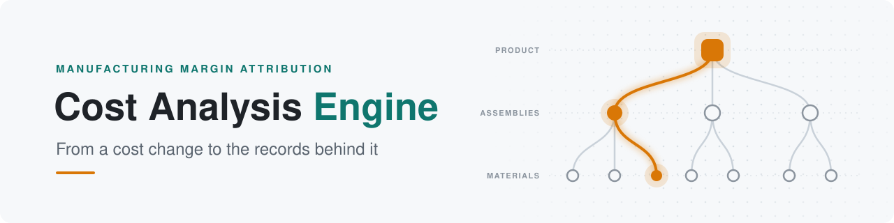
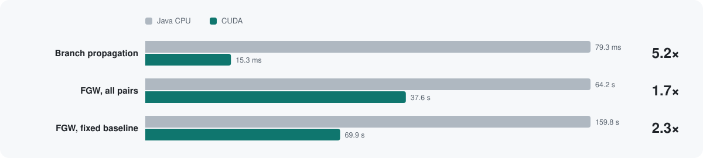
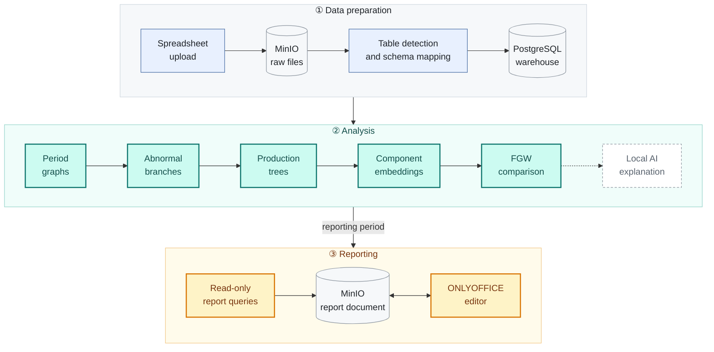
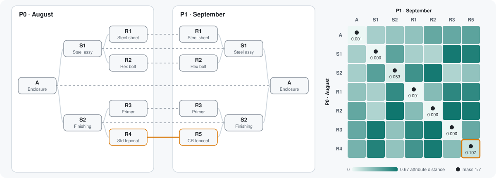

<div align="center">

<picture>
  <source media="(prefers-color-scheme: dark)" srcset="docs/images/banner-dark.svg">
  
</picture>

**English** &nbsp;·&nbsp; [简体中文](README.zh-CN.md)

<br>

**Intelligent Cost Analysis for Multi-Stage Production, Powered by Local AI**

<br>


[](LICENSE)

[**Quick start**](#-quick-start) &nbsp;·&nbsp; [**How it works**](#-how-it-works) &nbsp;·&nbsp; [**Worked example**](#-worked-example)

</div>

<br>

**Evidence-based cost variance analysis for multi-stage manufacturing: from a change in margin to the production records behind it.**

Cost Analysis Engine is a margin-attribution and variance-analysis application for finance, audit and data analysts in manufacturing. It consolidates sales, purchasing, production, inventory-usage, cost and bill-of-materials (BOM) records, compares two periods, and links each reported difference to its supporting records.

**GPU acceleration with CUDA.** Comparing production runs is a computationally intensive optimal-transport problem, because each pair of runs is matched at component level. The engine includes a native CUDA solver that performs the full calculation in FP64 on the GPU. It uses cuBLAS for matrix operations, an exact transportation simplex executed on the device, and persistent multi-stream sessions that compare many runs against a common baseline concurrently. Abnormal-branch discovery is also GPU-accelerated, and OpenCL supports non-NVIDIA devices. Where no supported GPU is available, all analysis runs on the CPU under the same specified numerical tolerances.

<picture>
  <source media="(prefers-color-scheme: dark)" srcset="docs/images/cuda-benchmark-dark.svg">
  
</picture>

<sub>Serial Java CPU vs CUDA, synthetic workloads on one workstation (Ryzen 7 9700X, RTX 5070 Ti): branch propagation over 10 million issue records; FGW over 79,800 all-pairs and 200,000 fixed-baseline comparisons. Gains depend on problem size.</sub>

<br>

## 🔍 The problem Cost Analysis Engine solves

When a product's costs rise and its margin falls, identifying the underlying causes requires finance and audit professionals to trace production relationships from finished goods through sub-assemblies and components to raw materials. At each level they must examine production activity for anomalies and reconcile production orders, material issues and cost records along every branch.

This work is labour-intensive and typically falls within the periods of greatest time pressure: month-end close, management reporting and audit. Three factors account for most of the effort:

| Factor | Effect on the analysis |
| :-- | :-- |
| **Fragmented data** | Sales, purchasing, production, issue and cost data are held in separate system exports and must be consolidated before analysis can begin. |
| **Shared materials** | A single raw material is consumed by many products, so one price change affects many branches, each of which must be examined. |
| **Cross-batch relationships** | Production runs consume the output of earlier batches, so the relevant evidence spans multiple orders and periods. |

In addition, actual material issues frequently differ from the planned BOM. Without component-level matching, a material substitution can appear as an unexplained reduction in one cost and an unrelated increase in another.

A standard report shows *that* unit cost has changed. It does not establish:

- **Where** the difference arises: which materials and sub-assemblies carry it.
- **What** changed: the price, the quantity consumed, or the material itself.
- **Which** production runs differ, and which issue, output and cost records support that conclusion.

<br>

## 🎯 The solution

Cost Analysis Engine automates this analytical workflow. It integrates the business records, identifies the branches in which costs differ, reconstructs the production structures actually recorded, and compares them run by run. Changes in aggregate figures are attributed to specific production orders, materials and source documents, so that each explanation is supported by verifiable evidence.

| Manual approach | Cost Analysis Engine |
| :-- | :-- |
| System exports are consolidated by hand | ERP exports are imported once; columns are recognised and original files are archived for audit |
| Each BOM level is reviewed to locate the change | Abnormal cost branches are identified against user-defined thresholds |
| Production is assumed to follow the planned BOM | Each production run is reconstructed from the issue, output and allocation records actually recorded |
| Substitutions are missed or treated as unrelated changes | Runs are matched at component level, so a replaced material is identified as a replacement |
| Figures are transcribed into management reports | Report placeholders are populated through validated, read-only queries |

**Key characteristics:**

- **Traceability.** Every reported figure can be traced to the source records from which it was derived.
- **Numerical precision.** Monetary values are calculated with exact decimal arithmetic. Missing or incomplete evidence is reported explicitly and never estimated.
- **Evidence-based AI.** A local language model may summarise findings in plain language, but all figures are produced by the backend's calculations.
- **Data residency.** Embeddings and AI explanations run on locally hosted models; no external cloud service is required.
- **Flexible execution.** All analysis runs on the CPU, with optional CUDA or OpenCL acceleration on supported GPUs.

> **The web interface is being redesigned.** Actual production trees become too large and interconnected to be read effectively as node-and-link diagrams. The next version will therefore present branches, production trees and run-to-run matches as structured, sortable data tables.
>
> Cost Analysis Engine is currently a **research prototype**. Its analysis follows documented specifications and validation reports, but it is not yet represented as production-ready.

<br>

## 🧩 How it works

The engine works in three phases. The raw files are stored in MinIO, the analysis runs in the Java backend, and the results end up in a report edited in ONLYOFFICE.



### ① Data preparation

Each uploaded spreadsheet is validated and stored unchanged in **MinIO**, so the original file is kept for audit. A background job then reads it from MinIO, detects the table boundaries, infers column types, maps the columns to the warehouse schema, and writes the records to **PostgreSQL**. Every import is tracked as a job with a clear status, from validation through storage and transformation to writing.

> **Production structure reconstructed from material-issue records alone.** In the current version, production material-issue records that carry a production order number are sufficient to reconstruct the material structure actually used in production. A maintained BOM, routing data and FIFO batch assumptions are not required. Labour and overhead allocations can be added when they are available. Without them, trees are still built and their totals are clearly marked as material-only.

### ② Analysis

You choose two periods, $t \in \{0, 1\}$, and two thresholds. The backend then runs five stages in order and reports progress as each one finishes. All money is held as exact decimals; the optimisation runs in FP64.

#### 1 · Period graphs

For each period, the sales and inventory-usage records are folded into a directed graph $G_t = (V_t, E_t)$ whose edges point from material to product. It is stored in **compressed sparse row (CSR)** form, so each traversal is a single $O(|V| + |E|)$ pass over two flat arrays. Each node $v$ carries its recorded cost $c_t(v)$. Materials that appear in only one period, or that lack comparable costs, are listed as diagnostics rather than dropped.

#### 2 · Abnormal branches: thresholded upward frontier

For each node present in both periods, the difference is encoded exactly in signed micro-units:

```math
\Delta(v) = c_1(v) - c_0(v), \qquad \Delta(v) \in 10^{-6}\,\mathbb{Z}
```

Leaves whose $|\Delta(\ell)| \ge \tau_{\text{leaf}}$ seed a frontier that propagates upwards. An ancestor becomes eligible once all of its participating children have arrived. It is **selected** as a branch boundary when $|\Delta(v)| \ge \tau_{\text{stop}}$; otherwise propagation continues. A selected node blocks its own ancestors, and child differences are never re-summed, so each reported path $\ell \to \dots \to v^\ast$ points to the lowest level at which the change becomes material.

#### 3 · Production trees: two-pass reconstruction from issue records

Every production order on an abnormal path, identified by the production order number on its issue records, is rebuilt as its own tree:

1. **Top-down scope.** Walk from the product root to every terminal material and record the permitted nodes $S$, relationships $E$ and root-to-leaf paths.
2. **Bottom-up evidence.** Query the actual issue records for those terminals and trace receivers upwards. A receiver is accepted only if it lies in $S$ through an edge in $E$. Anything else is kept as visible *excluded* evidence instead of being silently dropped.

Node totals are then computed from what was recorded, never from the planned BOM:

```math
\operatorname{cost}(v) \;=\; \sum_{\text{issues} \to v} \text{material amount} \;+\; \sum_{(u,v)} \bigl(\text{labour}_{uv} + \text{overhead}_{uv}\bigr)
```

> [!WARNING]
> **Current assumption: no cross-period work in progress.** Today every production order is assumed to be started and completed within the selected periods. Orders that are still in progress at a period boundary are not yet handled. The planned extension treats each minimal branch as its own window $w$ and closes it with the standard work-in-progress roll-forward:
>
> ```math
> \text{completed}_w \;=\; \text{opening WIP}_w \;+\; \text{issued in period}_w \;-\; \text{closing WIP}_w
> ```

#### 4 · Component embeddings: context-aware semantics

Each occurrence $v$ is described by a twelve-field canonical template $T(v)$: code, name, specification, supplier, category and unit cost, plus the codes, names and specifications of its direct upstream and downstream neighbours. The text is then encoded by a **local** sentence model:

```math
x_v = f_\theta\bigl(T(v)\bigr) \in \mathbb{R}^{384}
```

Identical inputs are deduplicated and cached, with the model revision, template version and a hash of the content as the key. Thousands of pairwise comparisons therefore reuse a small set of inference calls.

#### 5 · FGW comparison: matching by attributes and structural position

Two runs of the same product, with trees of $N$ and $M$ nodes, are compared with balanced **Fused Gromov–Wasserstein** optimal transport. The engine builds three inputs: an attribute cost $M_{ij} = \lVert x_i - y_j \rVert_2^2$, all-pairs shortest-path matrices $D_1$ and $D_2$ on the undirected trees, and uniform marginals $p = \tfrac{1}{N}\mathbf{1}$ and $q = \tfrac{1}{M}\mathbf{1}$. It then solves

```math
\min_{P \in \Pi(p,q)} \;(1-\alpha)\,\langle M, P\rangle \;+\; \alpha \sum_{i,k,j,l} \bigl(D_1[i,k] - D_2[j,l]\bigr)^2 P_{ij} P_{kl},
\qquad
\Pi(p,q) = \{P \ge 0 : P\mathbf{1} = p,\; P^{\top}\mathbf{1} = q\}
```

with $\alpha = 0.8$ by default. The quartic sum is never formed. For symmetric $D_1$ and $D_2$ it reduces to matrix products:

```math
H(P) = (D_1^{\odot 2}\, p)\,\mathbf{1}^{\top} + \mathbf{1}\,(D_2^{\odot 2}\, q)^{\top} - 2\, D_1 P D_2^{\top},
\qquad
\text{structure cost} = \langle H(P), P\rangle
```

**Frank–Wolfe** then iterates from $P_0 = pq^\top$:

```math
G = (1-\alpha) M + 2\alpha H(P), \qquad
S = \arg\min_{S \in \Pi(p,q)} \langle G, S\rangle, \qquad
P \leftarrow P + \gamma^\ast (S - P)
```

The linear step is solved **exactly** with a transportation simplex, with no entropic Sinkhorn smoothing and no forced one-to-one assignment, so that a substitution can be represented as a partial correspondence. Because the objective is quadratic along the search direction, $F(P + \gamma\Delta) = F(P) + b\gamma + a\gamma^2$, the optimal step $\gamma^\ast \in [0, 1]$ has a closed form. Iteration stops on a certified first-order condition:

```math
\text{gap} = \langle G, P - S\rangle \;\le\; \varepsilon_{\text{abs}} + \varepsilon_{\text{rel}} \max\bigl(|F(P)|, \varepsilon_{\text{floor}}\bigr)
```

The result is a soft correspondence between components. A substituted material, such as a standard topcoat replaced by a corrosion-resistant one, shows up as a **match** rather than as one unexplained loss and one unexplained gain. Each result also reports its material cost, structure cost, gap, iteration count and termination status separately.

<picture>
  <source media="(prefers-color-scheme: dark)" srcset="docs/images/fgw-correspondence-dark.svg">
  
</picture>

<sub>Recorded result for the <a href="#-worked-example">worked example</a>: the transport plan P (dots) over the attribute-cost matrix M (shading). R4 is matched to R5.</sub>

#### Execution paths

| | CPU | CUDA (NVIDIA) | OpenCL |
| :-- | :-- | :-- | :-- |
| Abnormal branches | Java frontier | Native frontier kernel | Native frontier kernel |
| FGW | Serial Java, FP64 | FP64 + cuBLAS batched GEMM, on-device exact simplex ( $N+M \le 320$ ), persistent multi-stream sessions | FP64, device simplex with persistent queues and buffers |

The caller chooses the engine family, and the backend reports which backend actually ran each stage. CUDA never silently falls back to OpenCL, or vice versa, and any CPU fallback is reported with its reason. GPU execution has been tested on a single NVIDIA GPU, with both CUDA and the NVIDIA OpenCL runtime; AMD and Intel devices and Windows/WSL2 have not been tested yet.

#### Explanations

For a selected material, the backend first classifies the change from the evidence, for example as a unit-cost change. A **local** llama.cpp model can then write a short explanation of that classification. The model only explains; it never produces the numbers.

### ③ Reporting

The analysis passes its reporting period to **Report Studio**. A DOCX report template contains placeholders. For each placeholder, you describe the figure you need, and the local AI turns that description into a structured query plan. The backend validates the plan, runs it as a **read-only** database query, and writes the result into the document. The document is stored in **MinIO** and opened in **ONLYOFFICE** for editing, and each save is written back to MinIO.

<br>

## 🧪 Worked example

The following example traces a single product end to end, using the shared fixture used by the analysis acceptance tests ([fixture](docs/algorithms/Analysis_Fixture.md) · [acceptance requirements](docs/algorithms/Analysis_Workflow_Test_Case.md)). An industrial control enclosure, product **A**, is made from a steel assembly (**S1**) and a finishing assembly (**S2**). Ten units are produced in each period.

```text
 August run (P0)                   September run (P1)
 A   Control enclosure             A   Control enclosure
 ├── S1  Steel assembly            ├── S1  Steel assembly
 │   ├── R1  Steel sheet           │   ├── R1  Steel sheet            ▲ +20
 │   └── R2  Hex bolt              │   └── R2  Hex bolt
 └── S2  Finishing assembly        └── S2  Finishing assembly
     ├── R3  Epoxy primer              ├── R3  Epoxy primer
     └── R4  Standard topcoat          └── R5  Corrosion-resistant    ⇄ +10
```

Unit cost rose from **NZD 24 to NZD 27**. The recorded evidence explains the full NZD 30 increase across the ten units:

| Component | Quantity | August | September | Change | What the records show |
| :-- | --: | --: | --: | --: | :-- |
| R1 Cold-rolled steel sheet | 20 kg | 100 | 120 | 🟠 **+20** | Same quantity, higher amount |
| R2 Hexagon bolt | 100 each | 20 | 20 | 0 | Unchanged |
| R3 Epoxy primer | 5 kg | 50 | 50 | 0 | Unchanged |
| R4 → R5 Topcoat | 5 kg | 30 | 40 | 🟠 **+10** | Standard topcoat replaced by a corrosion-resistant one |
| Labour and overhead (S1, S2 and A) | — | 40 | 40 | 0 | Unchanged |
| **Product A, ten units** | | **240** | **270** | **+30** | |

<sub>Amounts in NZD.</sub>

Each stage contributes part of this picture:

| Stage | Finding |
| :-- | :-- |
| ① Branch discovery | The steel-cost path from R1 through S1 to product A |
| ② Production trees | Both runs rebuilt from issue, output and allocation records, with complete totals of 240 and 270 |
| ③ FGW comparison | A component-by-component match; the test reports it against the expected pairing, including **R4 ⇄ R5**, so the topcoat change appears as a replacement |

<br>

## 🧭 Main workflows

| | Workflow | What you get |
| :-: | :-- | :-- |
| 📥 | **Data preparation** | Import spreadsheet exports from your ERP system. The engine recognises their columns, keeps the original files for audit, and loads the records into the warehouse. |
| 🗂️ | **Data browser** | Inspect the loaded warehouse records and download the archived raw files. |
| 🌳 | **Dual-BOM analysis** | Choose two periods and thresholds, find abnormal cost branches, and inspect the paths, production trees, comparisons and supporting records. |
| 📝 | **Report Studio** | Fill management-report placeholders from validated, read-only queries and edit the document in ONLYOFFICE. |
| ⚙️ | **Settings** | Configure the local llama.cpp connection, the report template, GPU preferences and the embedding model. |

<br>

## 🚀 Quick start

**Requirements:** Docker Engine with the Docker Compose plugin on Linux, or Docker Desktop in Linux container mode on macOS or Windows. Java, Maven and Node.js are not needed on the host.

```sh
cp .env.deploy.example .env.deploy
# Edit .env.deploy and set DB_PASSWORD, MINIO_SECRET_KEY (at least 8 characters)
# and ONLYOFFICE_JWT_SECRET (any long random string).
docker compose --env-file .env.deploy -f compose.deploy.yaml up -d --build
```

Then open **<http://localhost:18080>**. The first build downloads images and dependencies and can take several minutes. The database starts with sample data.

| Optional feature | Needs |
| :-- | :-- |
| Production-run comparison | The embedding model, installed from **Settings → Embedding model** |
| AI explanations and Report Studio blueprints | A llama.cpp server, configured under **Settings**. Without it, the analysis still runs and the AI text is reported as unavailable |
| GPU acceleration | A supported device; see [DEPLOYMENT.md](DEPLOYMENT.md). All analysis runs on the CPU without it |

See [DEPLOYMENT.md](DEPLOYMENT.md) for the full deployment instructions, including the optional NVIDIA CUDA backend and the anomaly investigation assistant.

<br>

## 🛠️ Development

<details>
<summary><b>Repository layout</b></summary>

<br>

| Path | Contents |
| :-- | :-- |
| `backend/` | Java 21 and Spring Boot backend: import pipeline, warehouse, analysis algorithms, reporting and settings |
| `frontend/` | React, TypeScript and Vite frontend |
| `backend/src/main/resources/cuda/`, `backend/src/main/resources/opencl/` | Native CUDA and OpenCL acceleration with JNI bindings |
| `docs/algorithms/` | Algorithm specifications and test cases |
| `benchmark/` | Java, CUDA and OpenCL benchmarks |
| `postgres/`, `minio/`, `scripts/` | Database image and backups, MinIO image, utility scripts |

</details>

<details>
<summary><b>Running the checks</b></summary>

<br>

The commands below run in Docker from the repository root.

```sh
# Backend tests, formatting check and packaging
docker run --rm -v "$PWD/backend:/workspace" -w /workspace maven:3.9-eclipse-temurin-21 \
  ./mvnw --batch-mode --no-transfer-progress clean verify

# Frontend type check and production build
docker build --target build -t margin-frontend-check -f frontend/Dockerfile frontend
```

Frontend unit tests run with Node.js 22 from `frontend/`, after `npm ci`: `node --experimental-strip-types --test src/*.test.ts`. Formatting is checked with `npm run format:check` (frontend) and Spotless (backend, part of `verify`).

</details>

<br>

## 🗺️ Roadmap

- [ ] Support work in progress that spans periods by treating each minimal branch as a window: completed = opening WIP + issued in period − closing WIP.
- [ ] Redesign the user interface. Large production trees become unreadable as graph drawings, so abnormal branches, production trees and run-to-run matches will be presented as structured, sortable data tables.
- [ ] Develop the local AI investigation assistant. A locally hosted model will combine the backend's computed evidence with engineering change notices, quality records and past cases to produce cited investigation reports. Verified facts will be kept separate from hypotheses, and all data will stay on premises.

<!-- Screenshot: add after the frontend redesign -->

<br>

## 📄 Licence

Licensed under the [Apache License 2.0](LICENSE).

<div align="center">
<br>
<sub>Built for analysts who need to show their working.</sub>
</div>
