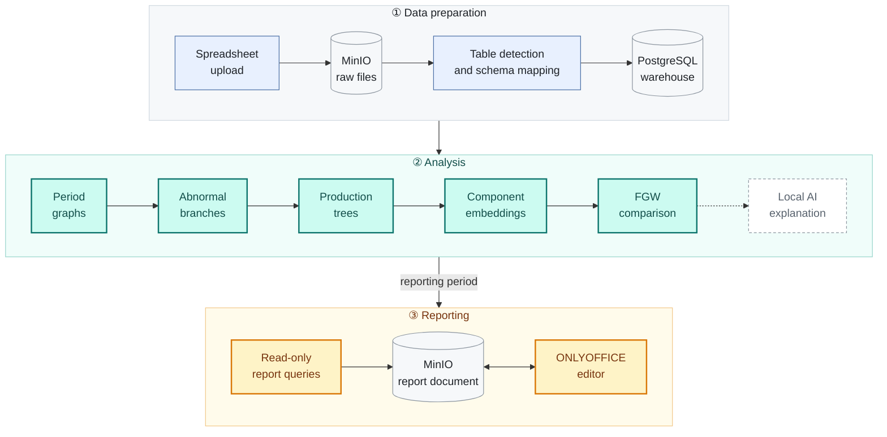

<div align="center">

<picture>
  <source media="(prefers-color-scheme: dark)" srcset="docs/images/banner-dark.svg">
  
</picture>

**English** &nbsp;·&nbsp; [简体中文](README.zh-CN.md)

<br>

**Intelligent Cost Analysis for Multi-Stage Production, Powered by Local AI**

<br>


[](LICENSE)

[**Quick start**](#-quick-start) &nbsp;·&nbsp; [**How it works**](#-how-it-works) &nbsp;·&nbsp; [**Worked example**](#-worked-example) &nbsp;·&nbsp; [**Status**](#-capability-status) &nbsp;·&nbsp; [**Docs**](#-documentation)

</div>

<br>

Cost Analysis Engine is a margin-attribution and variance-analysis application for financial and data analysts in manufacturing. It combines sales, purchasing, production, inventory-usage, cost and bill-of-materials (BOM) records, compares two periods, and shows the evidence behind every difference it reports.

<br>

## 🔍 The problem it answers

Cost Analysis Engine automates cost variance investigation, eliminating the need to manually and tediously trace through every production tier to isolate the root cause of a final report variance.

When a product's unit cost rises between periods, standard reports show that it rose. An analyst is then typically required to manually determine **why**:

- **Where** is the difference? Which materials and sub-assemblies carry it?

- **What** changed? The price, the quantity consumed, or the material itself?

- **Which** production runs behaved differently, and which issue, output and cost records support that conclusion?

The engine answers these questions directly from recorded data while keeping every figure traceable to its source records.

<br>

## 🧩 How it works

The engine works in three phases. The raw files are stored in MinIO, the analysis runs in the Java backend, and the results end up in a report edited in ONLYOFFICE.



### ① Data preparation

Each uploaded spreadsheet is validated and stored unchanged in **MinIO**, so the original file is kept for audit. A background job then reads it from MinIO, detects the table boundaries, infers column types, maps the columns to the warehouse schema, and writes the records to **PostgreSQL**. Every import is tracked as a job with a clear status, from validation through storage and transformation to writing.

### ② Analysis

You choose two periods and two thresholds. The backend then runs five stages in order and reports progress as each one finishes:

| Stage | What happens |
| :-- | :-- |
| **Period graphs** | Builds one graph per period from the sales and inventory-usage records, from sold products down to purchased materials, using exact decimal costs. Materials that appear in only one period or lack comparable costs are listed as diagnostics. |
| **Abnormal branches** | Compares the two graphs. Material cost differences above the leaf threshold are followed upwards until they reach a product or assembly above the stop threshold. The result is a set of abnormal paths back to the original records. |
| **Production trees** | For the products on those paths, rebuilds each production run (production ID) as a tree from the issue, output and processing-allocation records actually recorded. It does not rely on the planned BOM or on FIFO assumptions, and it reports incomplete evidence explicitly. |
| **Component embeddings** | Describes every component by its code, name, specification, supplier, cost and neighbours in the tree, then converts that description into a 384-dimensional vector with a **local** embedding model. |
| **FGW comparison** | Compares every pair of production runs of the same product with balanced Fused Gromov-Wasserstein optimal transport. Components are matched by *what they are* (embeddings) and *where they sit* (tree structure), so a substituted material appears as a correspondence rather than as an unexplained gap. |

Branch discovery and FGW comparison run on the CPU by default and can use CUDA or OpenCL when a supported GPU is available. If no supported GPU is available, the backend falls back to the CPU and reports that it did.

For a selected material, the backend first classifies the change from the evidence, for example as a unit-cost change. A **local** llama.cpp model can then write a short explanation of that classification. The model only explains; it never produces the numbers.

### ③ Reporting

The analysis passes its reporting period to **Report Studio**. A DOCX report template contains placeholders. For each placeholder, you describe the figure you need, and the local AI turns that description into a structured query plan. The backend validates the plan, runs it as a **read-only** database query, and writes the result into the document. The document is stored in **MinIO** and opened in **ONLYOFFICE** for editing, and each save is written back to MinIO.

<br>

## 🧪 Worked example

This is the shared fixture used by the analysis acceptance tests ([fixture](docs/algorithms/Analysis_Fixture.md) · [acceptance requirements](docs/algorithms/Analysis_Workflow_Test_Case.md)). An industrial control enclosure, product **A**, is made from a steel assembly (**S1**) and a finishing assembly (**S2**). Ten units are produced in each period.

```text
 August run (P0)                   September run (P1)
 A   Control enclosure             A   Control enclosure
 ├── S1  Steel assembly            ├── S1  Steel assembly
 │   ├── R1  Steel sheet           │   ├── R1  Steel sheet            ▲ +20
 │   └── R2  Hex bolt              │   └── R2  Hex bolt
 └── S2  Finishing assembly        └── S2  Finishing assembly
     ├── R3  Epoxy primer              ├── R3  Epoxy primer
     └── R4  Standard topcoat          └── R5  Corrosion-resistant    ⇄ +10
```

Unit cost rose from **NZD 24 to NZD 27**. The recorded evidence explains the full NZD 30 increase across the ten units:

| Component | Quantity | August | September | Change | What the records show |
| :-- | --: | --: | --: | --: | :-- |
| R1 Cold-rolled steel sheet | 20 kg | 100 | 120 | 🟠 **+20** | Same quantity, higher amount |
| R2 Hexagon bolt | 100 each | 20 | 20 | 0 | Unchanged |
| R3 Epoxy primer | 5 kg | 50 | 50 | 0 | Unchanged |
| R4 → R5 Topcoat | 5 kg | 30 | 40 | 🟠 **+10** | Standard topcoat replaced by a corrosion-resistant one |
| Labour and overhead (S1, S2 and A) | — | 40 | 40 | 0 | Unchanged |
| **Product A, ten units** | | **240** | **270** | **+30** | |

<sub>Amounts in NZD.</sub>

Each stage contributes part of this picture:

| Stage | Finding |
| :-- | :-- |
| ① Branch discovery | The steel-cost path from R1 through S1 to product A |
| ② Production trees | Both runs rebuilt from issue, output and allocation records, with complete totals of 240 and 270 |
| ③ FGW comparison | A component-by-component match; the test reports it against the expected pairing, including **R4 ⇄ R5**, so the topcoat change appears as a replacement |

> [!IMPORTANT]
> The engine reports these as **recorded differences**. It does not claim that the replacement was approved or that a price change was the cause.

<br>

## 🧭 Main workflows

| | Workflow | What you get |
| :-: | :-- | :-- |
| 📥 | **Data preparation** | Import spreadsheet exports from your ERP system. The engine recognises their columns, keeps the original files for audit, and loads the records into the warehouse. |
| 🗂️ | **Data browser** | Inspect the loaded warehouse records and download the archived raw files. |
| 🌳 | **Dual-BOM analysis** | Choose two periods and thresholds, find abnormal cost branches, and inspect the paths, production trees, comparisons and supporting records. |
| 📝 | **Report Studio** | Fill management-report placeholders from validated, read-only queries and edit the document in ONLYOFFICE. |
| ⚙️ | **Settings** | Configure the local llama.cpp connection, the report template, GPU preferences and the embedding model. |

<br>

## 📊 Capability status

| Capability | CPU | GPU <sub>(optional)</sub> | Validation |
| :-- | :-: | :-: | :-- |
| Import, warehouse loading and raw-file storage | ✅ | — | Backend tests |
| Period graphs and abnormal-branch discovery | ✅ | CUDA · OpenCL | [Branch tests](docs/algorithms/Abnormal_Branches_Test_Case.md), native device tests |
| Production-tree reconstruction | ✅ | — | [20 / 20 requirements passed](docs/validation/production-tree-two-pass-2026-10-11/validation.md) |
| Component embeddings | ✅ | CUDA | Numerical checks; semantic thresholds not yet calibrated |
| FGW comparison <sub>(FP64)</sub> | ✅ | CUDA · OpenCL | [Independent CPU and POT checks](docs/validation/production-tree-two-pass-2026-10-11/fgw-validation.md) |
| AI explanations | ◐ | — | Optional llama.cpp server; analysis runs without it |
| Report Studio | ✅ | — | Backend tests |
| Anomaly investigation assistant | 🧪 | — | Prototype API, disabled by default ([design](docs/algorithms/Anomaly_Investigation_RAG_Design.md)) |

<sub>✅ available &nbsp;·&nbsp; ◐ needs an optional external service &nbsp;·&nbsp; 🧪 experimental &nbsp;·&nbsp; — not applicable</sub>

> [!CAUTION]
> GPU execution has been tested on a single NVIDIA GPU, using both CUDA and the NVIDIA OpenCL runtime. AMD and Intel OpenCL devices, and GPU execution under Windows or WSL2, have not been tested. Without a usable device, the backend reports acceleration as unavailable and runs on the CPU.

<br>

## 🚀 Quick start

**Requirements:** Docker Engine with the Docker Compose plugin on Linux, or Docker Desktop in Linux container mode on macOS or Windows. Java, Maven and Node.js are not needed on the host.

```sh
cp .env.deploy.example .env.deploy
# Edit .env.deploy and set DB_PASSWORD, MINIO_SECRET_KEY (at least 8 characters)
# and ONLYOFFICE_JWT_SECRET (any long random string).
docker compose --env-file .env.deploy -f compose.deploy.yaml up -d --build
```

Then open **<http://localhost:18080>**. The first build downloads images and dependencies and can take several minutes. The database starts with sample data.

| Optional feature | Needs |
| :-- | :-- |
| Production-run comparison | The embedding model, installed from **Settings → Embedding model** |
| AI explanations and Report Studio blueprints | A llama.cpp server, configured under **Settings**. Without it, the analysis still runs and the AI text is reported as unavailable |
| GPU acceleration | A supported device; see [DEPLOYMENT.md](DEPLOYMENT.md). All analysis runs on the CPU without it |

See [DEPLOYMENT.md](DEPLOYMENT.md) for the full deployment instructions, including the optional NVIDIA CUDA backend and the anomaly investigation assistant.

<br>

## 📚 Documentation

| Topic | Documents |
| :-- | :-- |
| Analysis workflow | [Main analysis design](docs/algorithms/Main_Analysis_Design.md) |
| FGW comparison | [Algorithm design](docs/algorithms/FGW_Algorithm_Design.md) · [Five-step implementation](docs/algorithms/FGW_Implementation_Five_Steps.md) · [Numerical test case](docs/algorithms/FGW_Test_Case.md) |
| Production trees | [Construction rules](docs/algorithms/FGW_Build_Production_Trees.md) · [Test case](docs/algorithms/FGW_Build_Production_Trees_Test_Case.md) |
| Validation reports | [Production trees](docs/validation/production-tree-two-pass-2026-10-11/validation.md) · [FGW numerics](docs/validation/production-tree-two-pass-2026-10-11/fgw-validation.md) |
| Local AI explanations | [Local AI report](docs/LOCAL_AI_REPORT.md) |
| Optional GPU libraries | [Native accelerator bindings](backend/src/main/resources/native/README.md) |
| Deployment | [DEPLOYMENT.md](DEPLOYMENT.md) |

<br>

## 🛠️ Development

<details>
<summary><b>Repository layout</b></summary>

<br>

| Path | Contents |
| :-- | :-- |
| `backend/` | Java 21 and Spring Boot backend: import pipeline, warehouse, analysis algorithms, reporting and settings |
| `frontend/` | React, TypeScript and Vite frontend |
| `backend/src/main/resources/cuda/`, `backend/src/main/resources/opencl/` | Native CUDA and OpenCL acceleration with JNI bindings |
| `docs/algorithms/` | Algorithm specifications and test cases |
| `benchmark/` | Java, CUDA and OpenCL benchmarks |
| `postgres/`, `minio/`, `scripts/` | Database image and backups, MinIO image, utility scripts |

</details>

<details>
<summary><b>Running the checks</b></summary>

<br>

The commands below run in Docker from the repository root.

```sh
# Backend tests, formatting check and packaging
docker run --rm -v "$PWD/backend:/workspace" -w /workspace maven:3.9-eclipse-temurin-21 \
  ./mvnw --batch-mode --no-transfer-progress clean verify

# Frontend type check and production build
docker build --target build -t margin-frontend-check -f frontend/Dockerfile frontend
```

Frontend unit tests run with Node.js 22 from `frontend/`, after `npm ci`: `node --experimental-strip-types --test src/*.test.ts`. Formatting is checked with `npm run format:check` (frontend) and Spotless (backend, part of `verify`).

</details>

<br>

## 🗺️ Roadmap

- [ ] Redesign the web interface. Screenshots will be added once it is complete.
- [ ] Calibrate model-specific thresholds for the semantic quality of embedding-based matching.
- [ ] Integrate the standalone CUDA graph-construction library (`cuda/`) with the backend.
- [ ] Test acceleration on more devices and platforms.

<!-- Screenshot: add after the frontend redesign -->

<br>

## 📄 Licence

Licensed under the [Apache License 2.0](LICENSE).

<div align="center">
<br>
<sub>Built for analysts who need to show their working.</sub>
</div>
