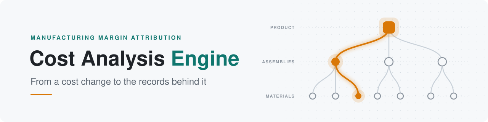
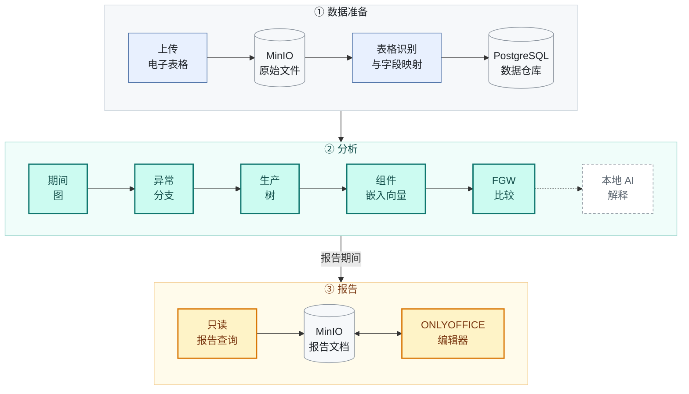

<div align="center">

<picture>
  <source media="(prefers-color-scheme: dark)" srcset="docs/images/banner-dark.svg">
  
</picture>

[English](README.md) &nbsp;·&nbsp; **简体中文**

<br>

**基于本地 AI 的多阶段生产智能成本分析**

<br>


[](LICENSE)

[**快速开始**](#-快速开始) &nbsp;·&nbsp; [**工作原理**](#-工作原理) &nbsp;·&nbsp; [**示例分析**](#-示例分析) &nbsp;·&nbsp; [**功能状态**](#-功能状态) &nbsp;·&nbsp; [**文档**](#-文档)

</div>

<br>

Cost Analysis Engine 是一款面向制造业财务分析师和数据分析师的毛利归因与差异分析应用。它整合销售、采购、生产、库存领用、成本和物料清单（BOM）记录，对比两个期间，并为报告的每一项差异给出依据。

<br>

## 🔍 解决的问题

Cost Analysis Engine 将成本差异调查自动化。分析师不必再逐层手动排查每一道生产环节，就能定位最终报表差异的根源。

当某产品的单位成本在两个期间之间上升时，标准报表只能说明成本上升了。分析师通常还需要手动查明**原因**：

- **在哪里**产生了差异？哪些物料和半成品承担了这部分差异？

- **什么**发生了变化？是价格、消耗数量，还是物料本身？

- **哪些**生产批次表现不同？哪些领料、产出和成本记录支持这一结论？

本引擎直接根据已记录的数据回答这些问题，并保证每一个数字都能追溯到其来源记录。

<br>

## 🧩 工作原理

本引擎分三个阶段运行：原始文件存入 MinIO，分析在 Java 后端完成，结果最终写入报告，并在 ONLYOFFICE 中编辑。



### ① 数据准备

每个上传的电子表格都会先经过校验，再原样存入 **MinIO**，保留原始文件以备审计。随后，后台任务从 MinIO 读取该文件，识别表格边界，推断各列的数据类型，将列映射到数据仓库的字段结构，并把记录写入 **PostgreSQL**。每次导入都作为一个任务进行跟踪，从校验、存储、转换到写入，每一步都有明确的状态。

### ② 分析

用户选择两个期间和两个阈值后，后端按顺序执行以下五个阶段，并在每个阶段完成时报告进度：

| 阶段 | 具体内容 |
| :-- | :-- |
| **期间图** | 根据销售和库存领用记录，为每个期间构建一张从已售产品到采购物料的图，成本使用精确的十进制数值计算。只在一个期间出现、或缺少可比成本的物料，会作为诊断信息列出。 |
| **异常分支** | 比较两张图。超过叶节点阈值的物料成本差异会被逐级向上追踪，直到到达超过停止阈值的产品或组件。结果是一组可回溯到原始记录的异常路径。 |
| **生产树** | 针对这些路径上的产品，根据实际记录的领料、产出和加工费用分摊记录，将每个生产批次（生产 ID）重建为一棵树。它不依赖计划 BOM 或先进先出（FIFO）假设，并会明确报告不完整的证据。 |
| **组件嵌入向量** | 用编码、名称、规格、供应商、成本以及在树中的相邻组件来描述每个组件，再通过**本地**嵌入模型把这段描述转换为 384 维向量。 |
| **FGW 比较** | 使用平衡的融合 Gromov-Wasserstein（FGW）最优传输，比较同一产品的每一对生产批次。组件同时按*它是什么*（嵌入向量）和*它在树中的位置*（树结构）进行匹配，因此被替换的物料会表现为一组对应关系，而不是一处无法解释的缺口。 |

异常分支识别和 FGW 比较默认在 CPU 上运行；如果有受支持的 GPU，也可以使用 CUDA 或 OpenCL 加速。没有可用的 GPU 时，后端会回退到 CPU，并报告这一情况。

对于选定的物料，后端会先根据证据对变化进行分类，例如“单位成本变化”。之后，**本地** llama.cpp 模型可以为该分类撰写一段简短的解释。模型只负责解释，从不生成数字。

### ③ 报告

分析会将其报告期间传递给 **Report Studio**。DOCX 报告模板中包含占位符。对每个占位符，用户描述所需的数据，本地 AI 会把描述转换为结构化的查询方案。后端校验该方案，以**只读**方式执行数据库查询，并把结果写入文档。文档存储在 **MinIO** 中，在 **ONLYOFFICE** 中打开编辑，每次保存都会写回 MinIO。

<br>

## 🧪 示例分析

以下是分析验收测试所使用的共享测试数据（[测试数据](docs/algorithms/Analysis_Fixture.md) · [验收要求](docs/algorithms/Analysis_Workflow_Test_Case.md)）。产品 **A** 是一个工业控制箱，由钢结构组件（**S1**）和表面处理组件（**S2**）组成。每个期间各生产十件。

```text
 八月批次（P0）                    九月批次（P1）
 A   控制箱                        A   控制箱
 ├── S1  钢结构组件                ├── S1  钢结构组件
 │   ├── R1  钢板                  │   ├── R1  钢板           ▲ +20
 │   └── R2  六角螺栓              │   └── R2  六角螺栓
 └── S2  表面处理组件              └── S2  表面处理组件
     ├── R3  环氧底漆                  ├── R3  环氧底漆
     └── R4  标准面漆                  └── R5  耐腐蚀面漆     ⇄ +10
```

单位成本从 **24 新西兰元上升到 27 新西兰元**。已记录的证据完整解释了这十件产品共 30 新西兰元的增加：

| 组件 | 数量 | 八月 | 九月 | 变化 | 记录显示 |
| :-- | --: | --: | --: | --: | :-- |
| R1 冷轧钢板 | 20 kg | 100 | 120 | 🟠 **+20** | 数量不变，金额上升 |
| R2 六角螺栓 | 100 个 | 20 | 20 | 0 | 无变化 |
| R3 环氧底漆 | 5 kg | 50 | 50 | 0 | 无变化 |
| R4 → R5 面漆 | 5 kg | 30 | 40 | 🟠 **+10** | 标准面漆被替换为耐腐蚀面漆 |
| 人工与制造费用（S1、S2 和 A） | — | 40 | 40 | 0 | 无变化 |
| **产品 A，十件** | | **240** | **270** | **+30** | |

<sub>金额单位：新西兰元（NZD）。</sub>

每个阶段各自提供了这一结论的一部分：

| 阶段 | 发现 |
| :-- | :-- |
| ① 异常分支识别 | 从 R1 经 S1 到产品 A 的钢材成本路径 |
| ② 生产树 | 根据领料、产出和分摊记录重建两个批次，完整总成本分别为 240 和 270 |
| ③ FGW 比较 | 逐个组件进行匹配；测试将结果与预期的对应关系（包括 **R4 ⇄ R5**）进行比对，因此面漆的变化表现为一次替换 |

> [!IMPORTANT]
> 本引擎将这些结果报告为**已记录的差异**。它不会声称该替换已获批准，也不会声称价格变化就是原因。

<br>

## 🧭 主要工作流程

| | 工作流程 | 你将获得 |
| :-: | :-- | :-- |
| 📥 | **数据准备** | 导入从 ERP 系统导出的电子表格。本引擎会识别其中的列，保留原始文件以备审计，并将记录载入数据仓库。 |
| 🗂️ | **数据浏览** | 查看已载入数据仓库的记录，并下载已归档的原始文件。 |
| 🌳 | **双 BOM 分析** | 选择两个期间和阈值，找出异常的成本分支，并查看路径、生产树、比较结果和支持记录。 |
| 📝 | **Report Studio** | 通过经过校验的只读查询填充管理报告的占位符，并在 ONLYOFFICE 中编辑文档。 |
| ⚙️ | **设置** | 配置本地 llama.cpp 连接、报告模板、GPU 偏好和嵌入模型。 |

<br>

## 📊 功能状态

| 功能 | CPU | GPU <sub>（可选）</sub> | 验证 |
| :-- | :-: | :-: | :-- |
| 导入、数据仓库载入和原始文件存储 | ✅ | — | 后端测试 |
| 期间图与异常分支识别 | ✅ | CUDA · OpenCL | [分支测试](docs/algorithms/Abnormal_Branches_Test_Case.md)、原生设备测试 |
| 生产树重建 | ✅ | — | [20 / 20 项要求通过](docs/validation/production-tree-two-pass-2026-10-11/validation.md) |
| 组件嵌入向量 | ✅ | CUDA | 数值检查通过；语义阈值尚未校准 |
| FGW 比较 <sub>（FP64）</sub> | ✅ | CUDA · OpenCL | [独立 CPU 与 POT 检查](docs/validation/production-tree-two-pass-2026-10-11/fgw-validation.md) |
| AI 解释 | ◐ | — | 可选的 llama.cpp 服务器；没有它分析也能运行 |
| Report Studio | ✅ | — | 后端测试 |
| 异常调查助手 | 🧪 | — | 原型 API，默认关闭（[设计文档](docs/algorithms/Anomaly_Investigation_RAG_Design.md)） |

<sub>✅ 可用 &nbsp;·&nbsp; ◐ 需要可选的外部服务 &nbsp;·&nbsp; 🧪 实验性 &nbsp;·&nbsp; — 不适用</sub>

> [!CAUTION]
> GPU 运行仅在一块 NVIDIA GPU 上测试过，覆盖 CUDA 和 NVIDIA OpenCL 运行时。AMD 和 Intel 的 OpenCL 设备，以及 Windows 或 WSL2 下的 GPU 运行，均未经测试。没有可用设备时，后端会报告加速不可用，并在 CPU 上运行。

<br>

## 🚀 快速开始

**环境要求：** Linux 上的 Docker Engine 及 Docker Compose 插件，或 macOS、Windows 上以 Linux 容器模式运行的 Docker Desktop。主机上无需安装 Java、Maven 或 Node.js。

```sh
cp .env.deploy.example .env.deploy
# 编辑 .env.deploy，设置 DB_PASSWORD、MINIO_SECRET_KEY（至少 8 个字符）
# 以及 ONLYOFFICE_JWT_SECRET（任意较长的随机字符串）。
docker compose --env-file .env.deploy -f compose.deploy.yaml up -d --build
```

然后打开 **<http://localhost:18080>**。首次构建需要下载镜像和依赖，可能需要几分钟。数据库启动时自带示例数据。

| 可选功能 | 需要 |
| :-- | :-- |
| 生产批次比较 | 嵌入模型，可在 **Settings → Embedding model**（设置 → 嵌入模型）中安装 |
| AI 解释和 Report Studio 查询方案 | 在 **Settings**（设置）中配置的 llama.cpp 服务器。没有它，分析仍可运行，AI 文本会显示为不可用 |
| GPU 加速 | 受支持的设备，详见 [DEPLOYMENT.md](DEPLOYMENT.md)。没有 GPU 时，所有分析都在 CPU 上运行 |

完整的部署说明（包括可选的 NVIDIA CUDA 后端和异常调查助手）见 [DEPLOYMENT.md](DEPLOYMENT.md)。

<br>

## 📚 文档

| 主题 | 文档 |
| :-- | :-- |
| 分析工作流程 | [主分析设计](docs/algorithms/Main_Analysis_Design.md) |
| FGW 比较 | [算法设计](docs/algorithms/FGW_Algorithm_Design.md) · [五步实现](docs/algorithms/FGW_Implementation_Five_Steps.md) · [数值测试用例](docs/algorithms/FGW_Test_Case.md) |
| 生产树 | [构建规则](docs/algorithms/FGW_Build_Production_Trees.md) · [测试用例](docs/algorithms/FGW_Build_Production_Trees_Test_Case.md) |
| 验证报告 | [生产树](docs/validation/production-tree-two-pass-2026-10-11/validation.md) · [FGW 数值](docs/validation/production-tree-two-pass-2026-10-11/fgw-validation.md) |
| 本地 AI 解释 | [本地 AI 报告](docs/LOCAL_AI_REPORT.md) |
| 可选 GPU 库 | [原生加速绑定](backend/src/main/resources/native/README.md) |
| 部署 | [DEPLOYMENT.md](DEPLOYMENT.md) |

<br>

## 🛠️ 开发

<details>
<summary><b>仓库结构</b></summary>

<br>

| 路径 | 内容 |
| :-- | :-- |
| `backend/` | Java 21 与 Spring Boot 后端：导入流程、数据仓库、分析算法、报告和设置 |
| `frontend/` | React、TypeScript 与 Vite 前端 |
| `backend/src/main/resources/cuda/`、`backend/src/main/resources/opencl/` | 带 JNI 绑定的原生 CUDA 和 OpenCL 加速 |
| `docs/algorithms/` | 算法规格说明和测试用例 |
| `benchmark/` | Java、CUDA 和 OpenCL 基准测试 |
| `postgres/`、`minio/`、`scripts/` | 数据库镜像与备份、MinIO 镜像、实用脚本 |

</details>

<details>
<summary><b>运行检查</b></summary>

<br>

以下命令在仓库根目录下通过 Docker 运行。

```sh
# 后端测试、格式检查和打包
docker run --rm -v "$PWD/backend:/workspace" -w /workspace maven:3.9-eclipse-temurin-21 \
  ./mvnw --batch-mode --no-transfer-progress clean verify

# 前端类型检查和生产构建
docker build --target build -t margin-frontend-check -f frontend/Dockerfile frontend
```

前端单元测试在 `frontend/` 目录下执行 `npm ci` 后，使用 Node.js 22 运行：`node --experimental-strip-types --test src/*.test.ts`。格式检查使用 `npm run format:check`（前端）和 Spotless（后端，包含在 `verify` 中）。

</details>

<br>

## 🗺️ 路线图

- [ ] 重新设计网页界面。完成后将补充截图。
- [ ] 为基于嵌入向量的匹配校准与模型相关的语义质量阈值。
- [ ] 将独立的 CUDA 图构建库（`cuda/`）集成到后端。
- [ ] 在更多设备和平台上测试加速功能。

<!-- Screenshot: add after the frontend redesign -->

<br>

## 📄 许可证

本项目基于 [Apache License 2.0](LICENSE) 许可发布。

<div align="center">
<br>
<sub>为需要拿出依据的分析师而打造。</sub>
</div>
