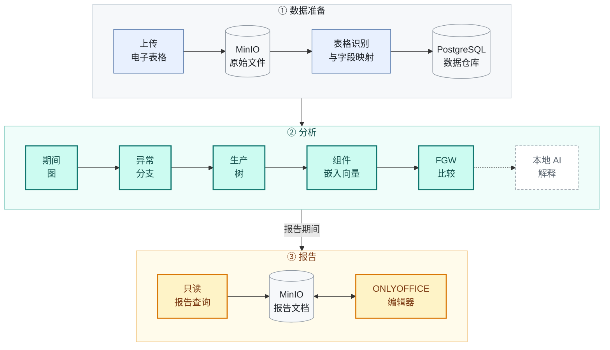

<div align="center">

<picture>
  <source media="(prefers-color-scheme: dark)" srcset="docs/images/banner-dark.svg">
  
</picture>

[English](README.md) &nbsp;·&nbsp; **简体中文**

<br>

**基于本地 AI 的多阶段生产智能成本分析**

<br>


[](LICENSE)

[**快速开始**](#-快速开始) &nbsp;·&nbsp; [**工作原理**](#-工作原理) &nbsp;·&nbsp; [**示例分析**](#-示例分析)

</div>

<br>

**面向多阶段制造的循证成本差异分析：从毛利变化追溯到背后的生产记录。**

Cost Analysis Engine 是一款面向制造业财务、审计和数据分析人员的毛利归因与差异分析应用。它整合销售、采购、生产、库存领用、成本和物料清单（BOM）记录，对比两个期间，并将报告的每一项差异关联到相应的支持性记录。

**基于 CUDA 的 GPU 加速。** 生产批次比较是一个计算密集型的最优传输问题，因为每一对批次都需要在组件层面进行匹配。本引擎内置原生 CUDA 求解器，以 FP64 精度在 GPU 上完成全部计算：矩阵运算使用 cuBLAS，精确运输单纯形法在设备端执行，持久化多流会话可将大量批次与同一基准批次并发比较。异常分支发现同样支持 GPU 加速，非 NVIDIA 设备可使用 OpenCL。在没有受支持 GPU 的环境中，所有分析均可在 CPU 上运行，并遵循相同的数值容差规定。

<br>

## 🔍 本项目解决的问题

当产品成本上升、毛利下降时，财务和审计人员为查明根本原因，需要沿着生产关系从产成品出发，经过半成品和零部件，逐层追溯至原材料。在每一层级，他们都要检查生产活动是否存在异常，并沿每条分支核对生产订单、领料记录和成本记录。

这项工作耗费大量人力，且通常集中在时间最紧张的阶段：月末结账、管理报告编制和审计期间。工作量主要来自以下三个因素：

| 因素 | 对分析工作的影响 |
| :-- | :-- |
| **数据分散** | 销售、采购、生产、领料和成本数据分别存放于不同的系统导出文件中，需要先行整合才能开展分析。 |
| **物料共用** | 同一种原材料被多种产品消耗，一次价格变化会影响多条分支，每条分支都需要逐一检查。 |
| **跨批次关联** | 生产批次会消耗前序批次的产出，相关证据因此分布在多个订单和期间之中。 |

此外，实际领料往往与计划 BOM 存在差异。若缺少组件层面的匹配，一次物料替代可能表现为一项成本无故减少、另一项无关成本同时增加。

标准报表能够反映单位成本*发生了变化*，但无法确定：

- **差异位置**：哪些物料和半成品承担了这部分差异。
- **变化内容**：是价格、消耗数量，还是物料本身发生了变化。
- **相关批次**：哪些生产批次存在差异，以及哪些领料、产出和成本记录支持这一结论。

<br>

## 🎯 解决方案

Cost Analysis Engine 将这一分析流程自动化。它整合业务记录，识别存在成本差异的分支，重建实际记录的生产结构，并逐批次进行比较。汇总数据的变化被归因到具体的生产订单、物料和原始单据，使每一项解释都有可核查的证据支持。

| 人工方式 | Cost Analysis Engine |
| :-- | :-- |
| 手工整合各系统导出文件 | ERP 导出文件一次导入，自动识别字段，原始文件归档以备审计 |
| 逐层审阅 BOM 以定位变化 | 依据用户设定的阈值识别异常成本分支 |
| 假定生产按计划 BOM 执行 | 根据实际记录的领料、产出和分摊记录重建每个生产批次 |
| 物料替代被遗漏或被视为无关变化 | 在组件层面匹配生产批次，被替代的物料会被识别为替代关系 |
| 手工将数据转录至管理报告 | 通过经校验的只读查询填充报告占位符 |

**主要特点：**

- **可追溯性。** 每一项报告数据都可追溯至其所依据的原始记录。
- **数值精确。** 金额采用精确小数运算。缺失或不完整的证据会被明确报告，不作估算。
- **基于证据的 AI。** 本地语言模型可用通俗语言总结分析结果，但所有数据均由后端计算产生。
- **数据本地化。** 嵌入和 AI 解释均在本地部署的模型上运行，无需依赖外部云服务。
- **灵活的执行方式。** 所有分析均可在 CPU 上运行，并可在受支持的 GPU 上选用 CUDA 或 OpenCL 加速。

> **网页界面正在重新设计。** 实际生产树的规模和关联关系过于复杂，难以通过节点连线图有效阅读。因此，下一版本将以结构化、可排序的数据表展示异常分支、生产树和批次间的匹配结果。

<br>

## 🧩 工作原理

本引擎分三个阶段运行：原始文件存入 MinIO，分析在 Java 后端完成，结果最终写入报告，并在 ONLYOFFICE 中编辑。



### ① 数据准备

每个上传的电子表格都会经过校验，并原样存入 **MinIO**，原始文件因此得以保留以备审计。随后，后台任务从 MinIO 读取文件，识别表格边界，推断字段类型，将字段映射到数据仓库结构，并把记录写入 **PostgreSQL**。每次导入都作为一个任务进行跟踪，从校验、存储、转换到写入，状态一目了然。

> **仅凭生产领料单即可重建实际生产结构。** 在当前版本中，带有生产订单号的生产领料单即足以还原生产中实际使用的物料结构，无需维护 BOM、工艺路线数据，也无需 FIFO 批次假设。如有人工和制造费用分摊数据，可以一并加入；没有这些数据时，生产树仍会照常构建，其总额会被明确标注为仅含材料成本。

### ② 分析

你选择两个期间 $t \in \{0, 1\}$ 和两个阈值，后端随即按顺序运行五个阶段，并在每个阶段完成时报告进度。所有金额均以精确小数保存，优化计算采用 FP64。

#### 1 · 期间图

对于每个期间，销售和库存领用记录被汇总为一个有向图 $G_t = (V_t, E_t)$，边的方向从物料指向产品。图以**压缩稀疏行（CSR）**格式存储，因此每次遍历只需对两个扁平数组做一次 $O(|V| + |E|)$ 的扫描。每个节点 $v$ 带有其记录成本 $c_t(v)$。只出现在一个期间、或缺少可比成本的物料会作为诊断信息列出，而不会被丢弃。

#### 2 · 异常分支：基于阈值的向上前沿传播

对于两个期间都存在的节点，差异以有符号微单位精确编码：

```math
\Delta(v) = c_1(v) - c_0(v), \qquad \Delta(v) \in 10^{-6}\,\mathbb{Z}
```

满足 $|\Delta(\ell)| \ge \tau_{\text{leaf}}$ 的叶节点作为种子，形成一个向上传播的前沿。祖先节点在其所有参与传播的子节点都到达后才具备资格。若 $|\Delta(v)| \ge \tau_{\text{stop}}$，该节点被**选为**分支边界；否则继续向上传播。被选中的节点会阻止其祖先继续被选中，且子节点差异不会被重新求和。因此，每条报告的路径 $\ell \to \dots \to v^\ast$ 都指向差异开始变得重要的最低层级。

#### 3 · 生产树：基于领料记录的两遍重建

异常路径上的每个生产订单（由其领料记录上的生产订单号标识）都会被重建为一棵独立的树：

1. **自上而下确定范围。** 从产品根节点遍历到每一个末端物料，记录允许的节点集合 $S$、关系集合 $E$ 以及从根到叶的路径。
2. **自下而上收集证据。** 查询这些末端物料的实际领料记录，并向上追踪接收方。只有通过 $E$ 中的边、且位于 $S$ 内的接收方才会被接受；其他记录会作为可见的*已排除*证据保留，而不是被悄悄丢弃。

随后，节点总额根据实际记录计算，而不是根据计划 BOM：

```math
\operatorname{cost}(v) \;=\; \sum_{\text{issues} \to v} \text{material amount} \;+\; \sum_{(u,v)} \bigl(\text{labour}_{uv} + \text{overhead}_{uv}\bigr)
```

> **当前假设：不存在跨期在产品。** 目前假设每个生产订单都在选定期间内开工并完工，尚未处理在期间边界仍未完工的在产品订单。计划中的扩展会把每一个最小分支视为一个独立的窗口 $w$，并按标准的在产品结转关系进行平衡：
>
> ```math
> \text{本期完工}_w \;=\; \text{期初在产品}_w \;+\; \text{本期领料}_w \;-\; \text{期末在产品}_w
> ```

#### 4 · 组件嵌入：感知上下文的语义表示

每个出现节点 $v$ 都由一个包含十二个字段的规范模板 $T(v)$ 描述：编码、名称、规格、供应商、类别和单位成本，以及其直接上游和下游邻居的编码、名称和规格。随后，这段文本由一个**本地**句向量模型编码：

```math
x_v = f_\theta\bigl(T(v)\bigr) \in \mathbb{R}^{384}
```

相同的输入会被去重并缓存，缓存键包含模型版本、模板版本和内容哈希。因此，成千上万次两两比较只需复用少量推理调用。

#### 5 · FGW 比较：同时依据属性和结构位置进行匹配

对同一产品的两个生产批次（其生产树分别有 $N$ 和 $M$ 个节点），引擎使用平衡的 **Fused Gromov–Wasserstein** 最优传输进行比较。引擎先构建三类输入：属性代价 $M_{ij} = \lVert x_i - y_j \rVert_2^2$，在无向树上计算的全源最短路径矩阵 $D_1$ 和 $D_2$，以及均匀边际分布 $p = \tfrac{1}{N}\mathbf{1}$ 和 $q = \tfrac{1}{M}\mathbf{1}$。然后求解

```math
\min_{P \in \Pi(p,q)} \;(1-\alpha)\,\langle M, P\rangle \;+\; \alpha \sum_{i,k,j,l} \bigl(D_1[i,k] - D_2[j,l]\bigr)^2 P_{ij} P_{kl},
\qquad
\Pi(p,q) = \{P \ge 0 : P\mathbf{1} = p,\; P^{\top}\mathbf{1} = q\}
```

默认 $\alpha = 0.8$。四重求和从不显式展开。对于对称的 $D_1$ 和 $D_2$，它可以化简为矩阵乘积：

```math
H(P) = (D_1^{\odot 2}\, p)\,\mathbf{1}^{\top} + \mathbf{1}\,(D_2^{\odot 2}\, q)^{\top} - 2\, D_1 P D_2^{\top},
\qquad
\text{structure cost} = \langle H(P), P\rangle
```

随后，**Frank–Wolfe** 算法从 $P_0 = pq^\top$ 开始迭代：

```math
G = (1-\alpha) M + 2\alpha H(P), \qquad
S = \arg\min_{S \in \Pi(p,q)} \langle G, S\rangle, \qquad
P \leftarrow P + \gamma^\ast (S - P)
```

线性子问题使用运输单纯形法**精确**求解，既不使用熵正则化的 Sinkhorn 平滑，也不强制一对一指派，因此物料替代可以表示为部分对应关系。由于目标函数沿搜索方向是二次的，即 $F(P + \gamma\Delta) = F(P) + b\gamma + a\gamma^2$，最优步长 $\gamma^\ast \in [0, 1]$ 有闭式解。迭代在满足可验证的一阶条件时停止：

```math
\text{gap} = \langle G, P - S\rangle \;\le\; \varepsilon_{\text{abs}} + \varepsilon_{\text{rel}} \max\bigl(|F(P)|, \varepsilon_{\text{floor}}\bigr)
```

结果是组件之间的软对应关系。被替代的物料（例如普通面漆换成耐腐蚀面漆）会显示为一个**匹配**，而不是一项无法解释的减少加一项无法解释的增加。每个结果还会分别报告材料代价、结构代价、Frank–Wolfe 间隙、迭代次数和终止状态。

#### 执行路径

| | CPU | CUDA（NVIDIA） | OpenCL |
| :-- | :-- | :-- | :-- |
| 异常分支 | Java 前沿传播 | 原生前沿内核 | 原生前沿内核 |
| FGW | 串行 Java，FP64 | FP64 + cuBLAS 批量矩阵乘法，设备端精确单纯形法（ $N+M \le 320$ ），持久化多流会话 | FP64，设备端单纯形法，持久化命令队列与缓冲区 |

引擎族由调用方选择，后端会报告每个阶段实际运行在哪个后端上。CUDA 不会悄悄回退到 OpenCL，反之亦然；任何 CPU 回退都会连同原因一起报告。GPU 执行已在一块 NVIDIA GPU 上通过 CUDA 和 NVIDIA OpenCL 运行时测试；AMD、Intel 设备以及 Windows/WSL2 环境尚未测试。

#### 解释

对于选定的物料，后端首先根据证据对变化进行分类，例如单位成本变化。随后，**本地** llama.cpp 模型可以为该分类撰写一段简短解释。模型只负责解释，从不生成数字。

### ③ 报告

分析会将其报告期间传递给 **Report Studio**。DOCX 报告模板中包含占位符。对每个占位符，用户描述所需的数据，本地 AI 会把描述转换为结构化的查询方案。后端校验该方案，以**只读**方式执行数据库查询，并把结果写入文档。文档存储在 **MinIO** 中，在 **ONLYOFFICE** 中打开编辑，每次保存都会写回 MinIO。

<br>

## 🧪 示例分析

以下示例基于分析验收测试所使用的共享测试数据，完整演示单个产品的追溯过程（[测试数据](docs/algorithms/Analysis_Fixture.md) · [验收要求](docs/algorithms/Analysis_Workflow_Test_Case.md)）。产品 **A** 是一个工业控制箱，由钢结构组件（**S1**）和表面处理组件（**S2**）组成。每个期间各生产十件。

```text
 八月批次（P0）                    九月批次（P1）
 A   控制箱                        A   控制箱
 ├── S1  钢结构组件                ├── S1  钢结构组件
 │   ├── R1  钢板                  │   ├── R1  钢板           ▲ +20
 │   └── R2  六角螺栓              │   └── R2  六角螺栓
 └── S2  表面处理组件              └── S2  表面处理组件
     ├── R3  环氧底漆                  ├── R3  环氧底漆
     └── R4  标准面漆                  └── R5  耐腐蚀面漆     ⇄ +10
```

单位成本从 **24 新西兰元上升到 27 新西兰元**。已记录的证据完整解释了这十件产品共 30 新西兰元的增加：

| 组件 | 数量 | 八月 | 九月 | 变化 | 记录显示 |
| :-- | --: | --: | --: | --: | :-- |
| R1 冷轧钢板 | 20 kg | 100 | 120 | 🟠 **+20** | 数量不变，金额上升 |
| R2 六角螺栓 | 100 个 | 20 | 20 | 0 | 无变化 |
| R3 环氧底漆 | 5 kg | 50 | 50 | 0 | 无变化 |
| R4 → R5 面漆 | 5 kg | 30 | 40 | 🟠 **+10** | 标准面漆被替换为耐腐蚀面漆 |
| 人工与制造费用（S1、S2 和 A） | — | 40 | 40 | 0 | 无变化 |
| **产品 A，十件** | | **240** | **270** | **+30** | |

<sub>金额单位：新西兰元（NZD）。</sub>

每个阶段各自提供了这一结论的一部分：

| 阶段 | 发现 |
| :-- | :-- |
| ① 异常分支识别 | 从 R1 经 S1 到产品 A 的钢材成本路径 |
| ② 生产树 | 根据领料、产出和分摊记录重建两个批次，完整总成本分别为 240 和 270 |
| ③ FGW 比较 | 逐个组件进行匹配；测试将结果与预期的对应关系（包括 **R4 ⇄ R5**）进行比对，因此面漆的变化表现为一次替换 |

<br>

## 🧭 主要工作流程

| | 工作流程 | 你将获得 |
| :-: | :-- | :-- |
| 📥 | **数据准备** | 导入从 ERP 系统导出的电子表格。本引擎会识别其中的列，保留原始文件以备审计，并将记录载入数据仓库。 |
| 🗂️ | **数据浏览** | 查看已载入数据仓库的记录，并下载已归档的原始文件。 |
| 🌳 | **双 BOM 分析** | 选择两个期间和阈值，找出异常的成本分支，并查看路径、生产树、比较结果和支持记录。 |
| 📝 | **Report Studio** | 通过经过校验的只读查询填充管理报告的占位符，并在 ONLYOFFICE 中编辑文档。 |
| ⚙️ | **设置** | 配置本地 llama.cpp 连接、报告模板、GPU 偏好和嵌入模型。 |

<br>

## 🚀 快速开始

**环境要求：** Linux 上的 Docker Engine 及 Docker Compose 插件，或 macOS、Windows 上以 Linux 容器模式运行的 Docker Desktop。主机上无需安装 Java、Maven 或 Node.js。

```sh
cp .env.deploy.example .env.deploy
# 编辑 .env.deploy，设置 DB_PASSWORD、MINIO_SECRET_KEY（至少 8 个字符）
# 以及 ONLYOFFICE_JWT_SECRET（任意较长的随机字符串）。
docker compose --env-file .env.deploy -f compose.deploy.yaml up -d --build
```

然后打开 **<http://localhost:18080>**。首次构建需要下载镜像和依赖，可能需要几分钟。数据库启动时自带示例数据。

| 可选功能 | 需要 |
| :-- | :-- |
| 生产批次比较 | 嵌入模型，可在 **Settings → Embedding model**（设置 → 嵌入模型）中安装 |
| AI 解释和 Report Studio 查询方案 | 在 **Settings**（设置）中配置的 llama.cpp 服务器。没有它，分析仍可运行，AI 文本会显示为不可用 |
| GPU 加速 | 受支持的设备，详见 [DEPLOYMENT.md](DEPLOYMENT.md)。没有 GPU 时，所有分析都在 CPU 上运行 |

完整的部署说明（包括可选的 NVIDIA CUDA 后端和异常调查助手）见 [DEPLOYMENT.md](DEPLOYMENT.md)。

<br>

## 🛠️ 开发

<details>
<summary><b>仓库结构</b></summary>

<br>

| 路径 | 内容 |
| :-- | :-- |
| `backend/` | Java 21 与 Spring Boot 后端：导入流程、数据仓库、分析算法、报告和设置 |
| `frontend/` | React、TypeScript 与 Vite 前端 |
| `backend/src/main/resources/cuda/`、`backend/src/main/resources/opencl/` | 带 JNI 绑定的原生 CUDA 和 OpenCL 加速 |
| `docs/algorithms/` | 算法规格说明和测试用例 |
| `benchmark/` | Java、CUDA 和 OpenCL 基准测试 |
| `postgres/`、`minio/`、`scripts/` | 数据库镜像与备份、MinIO 镜像、实用脚本 |

</details>

<details>
<summary><b>运行检查</b></summary>

<br>

以下命令在仓库根目录下通过 Docker 运行。

```sh
# 后端测试、格式检查和打包
docker run --rm -v "$PWD/backend:/workspace" -w /workspace maven:3.9-eclipse-temurin-21 \
  ./mvnw --batch-mode --no-transfer-progress clean verify

# 前端类型检查和生产构建
docker build --target build -t margin-frontend-check -f frontend/Dockerfile frontend
```

前端单元测试在 `frontend/` 目录下执行 `npm ci` 后，使用 Node.js 22 运行：`node --experimental-strip-types --test src/*.test.ts`。格式检查使用 `npm run format:check`（前端）和 Spotless（后端，包含在 `verify` 中）。

</details>

<br>

## 🗺️ 路线图

- [ ] 围绕数据表重新设计网页界面，用于展示异常分支、生产树和批次匹配结果。完成后将补充截图。
- [ ] 支持跨期在产品：将每一个最小分支视为一个窗口，按“本期完工 = 期初在产品 + 本期领料 − 期末在产品”进行平衡。
- [ ] 为基于嵌入向量的匹配校准与模型相关的语义质量阈值。
- [ ] 将独立的 CUDA 图构建库（`cuda/`）集成到后端。
- [ ] 在更多设备和平台上测试加速功能。

<!-- Screenshot: add after the frontend redesign -->

<br>

## 📄 许可证

本项目基于 [Apache License 2.0](LICENSE) 许可发布。

<div align="center">
<br>
<sub>为需要拿出依据的分析师而打造。</sub>
</div>
